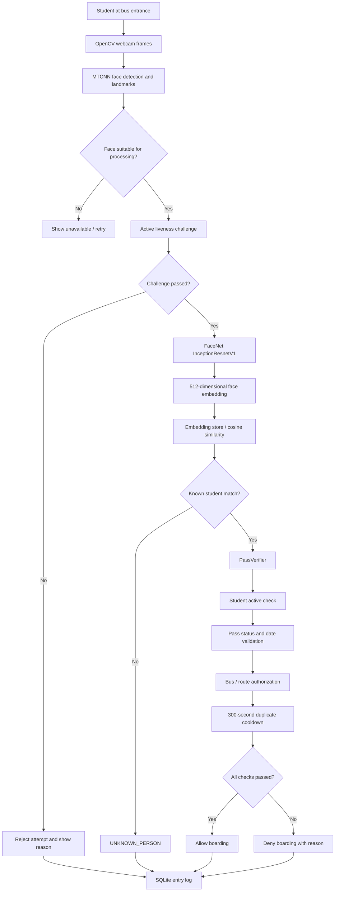
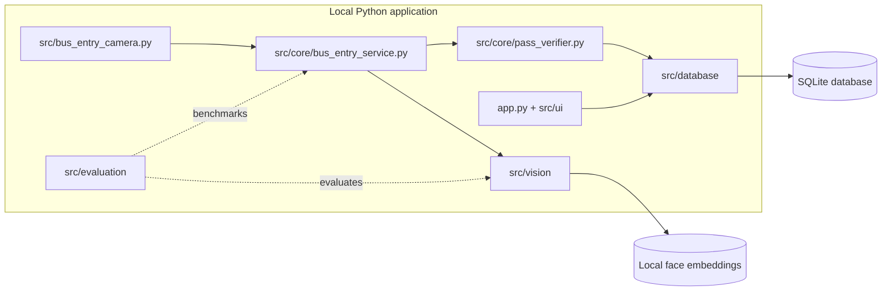

# SmartBusFaceRecognition — Architecture

This document describes the architecture represented by the current repository. The system is an educational prototype; see the README's limitations and privacy sections before treating it as a deployment design.

## 1. Live bus-entry verification flow

## 2. Application components

## 3. Main verification responsibilities

| Component | Responsibility |
|---|---|
| `src/vision/face_detector.py` | Detect faces and extract facial landmarks with MTCNN |
| `src/vision/liveness.py` | Run the active head-movement challenge |
| `src/vision/face_recognizer.py` | Generate FaceNet facial feature vectors |
| `src/vision/embedding_store.py` | Store and compare enrolled embeddings |
| `src/core/pass_verifier.py` | Apply student, pass, date, route, and cooldown rules |
| `src/database/` | SQLite schema, connections, CRUD, and dashboard queries |
| `src/ui/` | Streamlit administration pages |

## 4. Key configured rules

- Recognition threshold: cosine similarity **0.60** by default.
- Duplicate boarding cooldown: **300 seconds**.
- Liveness is enabled and required for entry by default.
- Default terminal route values: **BUS-12 / R-101**.

Values are configurable in `src/config.py`. Check the current source before changing thresholds or using a different bus configuration.

## 5. Data handling boundary

The intended runtime is local: webcam frames are processed by the Python application, while student/pass records and entry events are handled by SQLite. Face embeddings are stored locally. Protect the database, enrollment images, and embedding files as sensitive biometric and student information. Provide a manual ID-check fallback whenever automated verification is inconclusive.
